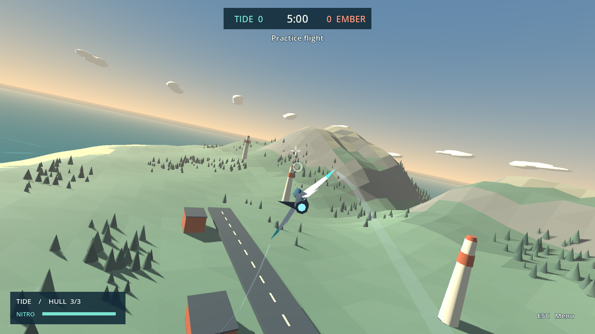

# Breakwater

A local multiplayer jet game for Windows. Fly through the mountain pass on Kestrel Island, bank around the coastal airfield, and chase the opposing team over the water. One laptop hosts up to four pilots. A solo practice flight uses the same aircraft and island.



[Download the Windows game or watch the 30-second practice flight](https://github.com/0xmostafaa/breakwater-air-circuit/releases/tag/v0.1.0)

## Play

1. Download the Windows ZIP. Extract it and double-click **Breakwater.exe**. Keep **Breakwater.pck** beside the executable.
2. Choose **Practice flight** to learn the controls. To play together, connect the laptops to the same Wi-Fi and have one pilot choose **Host LAN match**.
3. Enter the host's displayed Wi-Fi IPv4 address on the other laptops and choose **Join by IP**. If the host lists multiple addresses, use the Wi-Fi adapter's IPv4 address from Windows `ipconfig`.

The match starts when a second pilot joins. The host assigns teams, awards one point per elimination, and offers a rematch. Each jet has three hull points and respawns after three seconds. First to five wins. After five minutes, the higher score wins and equal scores draw. The host can close the session through the flight menu.

| Input | Action |
| --- | --- |
| W / S | Climb / dive while held |
| A / D | Bank and turn left / right |
| Mouse | Move the steering ring. Center it to hold direction. The small cross shows the blaster's aim. |
| Space | Hold for up to two seconds of boost. Release to recharge. |
| Left mouse | Hold to fire |
| Esc | Open or close the flight menu. Other pilots keep flying. |

For LAN connection trouble, check that Windows allows the host application on the private network and that the Wi-Fi permits devices to reach each other over UDP port **28741**. A private hotspot also works. WAN matchmaking and host migration are outside this prototype.

## Develop and review

Import `project.godot` in **Godot 4.7.2 Standard** and press **F6** with the main scene open or **F5** from the project. The project uses GDScript, the Compatibility renderer, and ENet. The island, aircraft, materials, and sounds are generated locally by the game.

### OpenGL in the submitted demo

The Windows v0.1.0 build ran on **OpenGL 3.3** on the development laptop. The packaged game's startup log identified the renderer as `OpenGL API 3.3.0 NVIDIA 572.16 - Compatibility - Using Device: NVIDIA - NVIDIA GeForce GTX 1050 Ti`. Godot issues the OpenGL calls. The game supplies procedural mesh data and a custom water shader written in Godot's shading language.

To check the renderer on another Windows laptop, extract the game, open PowerShell in its folder, and run:

```powershell
$log = Join-Path $env:TEMP 'breakwater-renderer.log'
Start-Process -FilePath '.\Breakwater.exe' -ArgumentList @('--quit-after', '60', '--log-file', ('"{0}"' -f $log)) -Wait
Select-String -LiteralPath $log -Pattern 'OpenGL|Vulkan|Direct3D'
```

| File | Responsibility |
| --- | --- |
| `game.gd` | Host/join lifecycle, match rules, input transport, host simulation, camera, audio |
| `aircraft.gd` | Flight dynamics, jet mesh, boost, and interpolation of replicated aircraft |
| `island.gd`, `water.gdshader` | Island geometry, collision, landmarks, sea, and lighting |
| `interface.gd` | Menu, controls, HUD, and results |
| `tests/check.gd`, `tests/check.ps1` | Repeatable flight, two-player, and four-player checks |

The host simulates movement, shots, damage, respawns, scores, and the clock. Clients send steering and button state. The host sends snapshots at 30 Hz, and clients interpolate between updates. Both peers construct the island from fixed seeds. The host tests terrain height against the same triangles the renderer draws.

From PowerShell in the project root, provide the path to the Godot editor executable:

```powershell
.\tests\check.ps1 -Godot 'C:\Tools\Godot\Godot_v4.7.2-stable_win64.exe'
```

The runner starts separate headless processes on the loopback interface. It checks flight inputs, boost, respawn, remote controls, scoring, rematch, a timed draw, team allocation, and disconnect cleanup. Each run writes logs under `.review`. Close any game hosting on port 28741 before running it. A physical two-laptop Wi-Fi playtest and frame-rate measurements on the classroom hardware are the remaining demo checks.

To export, install Godot's matching Windows x86_64 export templates and choose **Project → Export → Windows Desktop → Export Project**. Distribute the generated executable and game pack together.

## Credits

Built as a university computer graphics project with AI-assisted development. The jet, landscape, effects, and synthesized audio are procedural assets in this repository. The runtime uses [Godot Engine and its third-party libraries](https://godotengine.org/license/). Engine notices are included with the Windows build.
